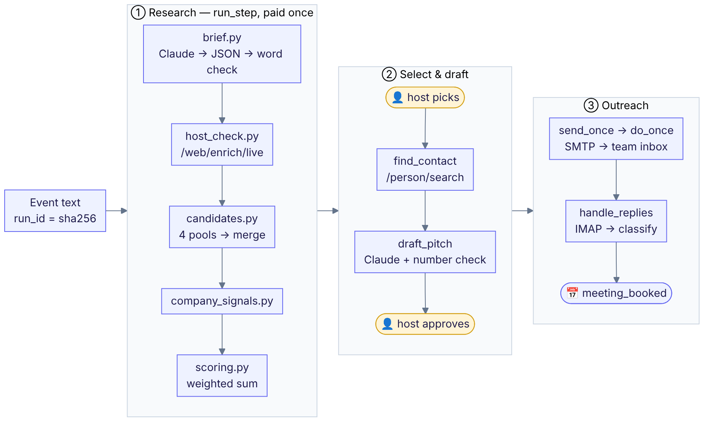
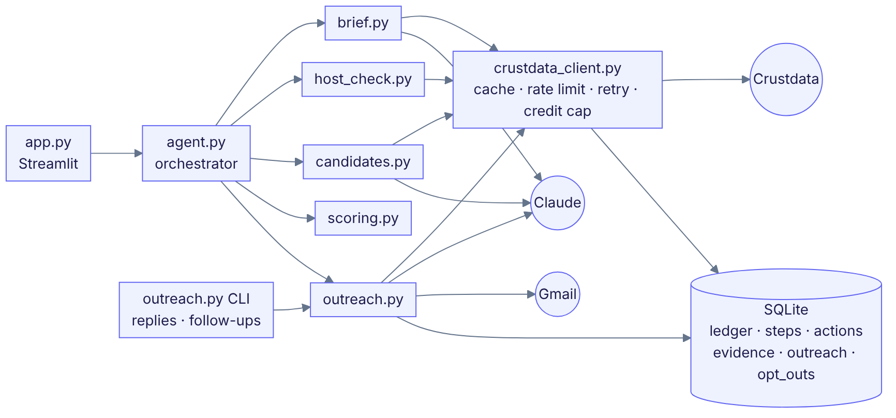
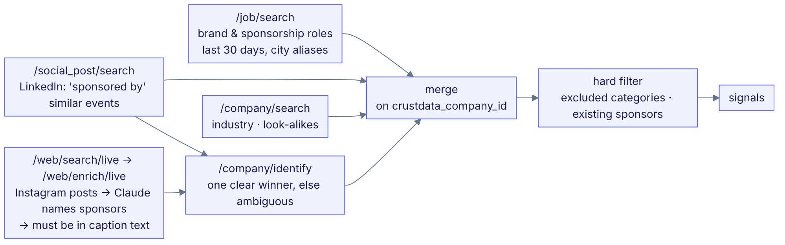
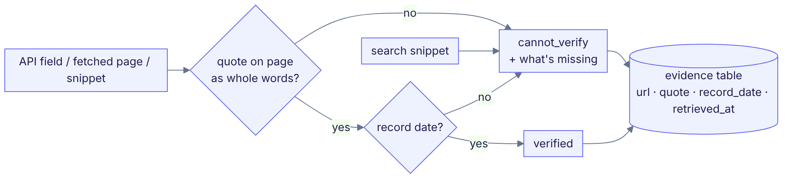
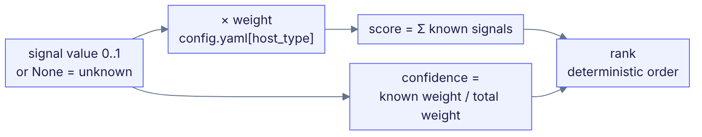
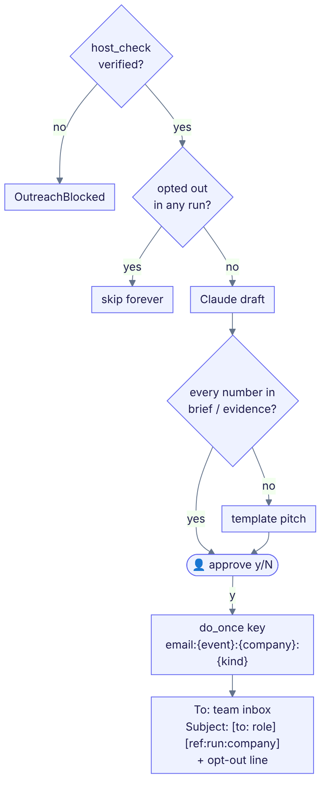
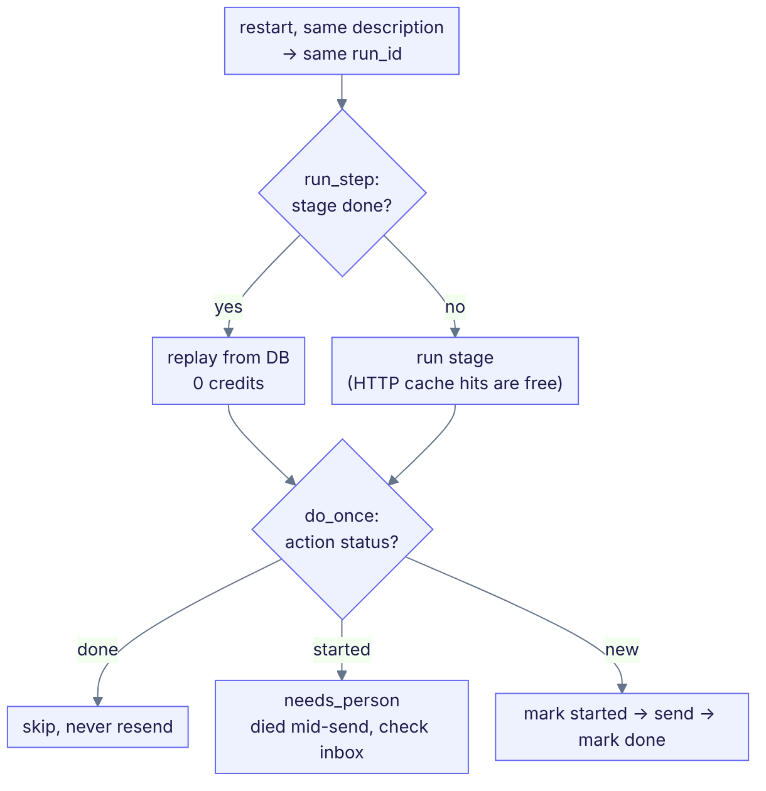
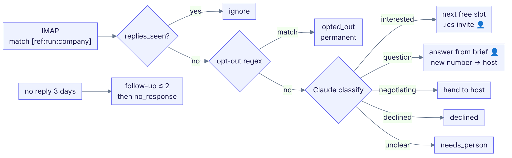
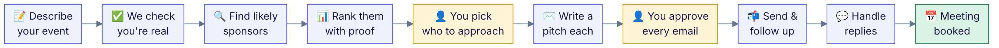
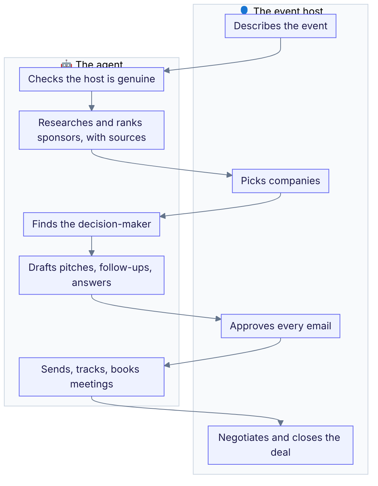

Demo Link: https://drive.google.com/drive/folders/1elx039-q8ic_6FEl5Tp26PNOUpwPJ7Yh?usp=share_link
    Site (if needed): moonlit-nasturtium-9ebaf2.netlify.app/


# Sponsorship agent for medium-scale events in India

ContextCon 05 (BITS Pilani), theme "Services, Replaced". An agent that does the job an
event's sponsorship team or agency is paid for: from the host's description of the event
to meetings booked with sponsor decision-makers.

> Numbers marked **[gap]** need a sourced figure before submission; don't fill them from memory.

## Run it

```
pip install -r requirements.txt
set CRUSTDATA_API_KEY and ANTHROPIC_API_KEY in your environment
streamlit run app.py
```

Pick an example from `demo/` or describe your event, then **Run**. The screen shows the brief,
the host check, ranked sponsors with the evidence behind each one, then the pitches to approve
and the pipeline.

- **Replay from cache:** the switch on the screen replays a description that already ran once,
  with no API or model calls. This is the backup for the demo.
- **Email:** with `OUTREACH_SENDER`, `OUTREACH_TEAM_INBOX` and `OUTREACH_APP_PASSWORD` set, approved
  emails go to the team Gmail inbox. Without them they are written to `outbox/`.
- **Replies:** `python outreach.py replies RUN_ID brief.json` (the screen offers `brief.json`).
- **Tests:** `python -m unittest discover -s tests` (offline, no keys needed).

### The web screen (`web/`)

```
python web/server.py            # http://127.0.0.1:8000, for hosts
python web/server.py --debug    # adds a Debug toggle: weights, scores, costs
python web/server.py --offline  # replay events that already ran online; no API calls
```

The same job as `app.py` with a designed page: describe the event, see the brief and host
check, ranked sponsors with company logos and every sourced fact, pick companies, approve each
pitch, send, and follow the pipeline. Weights, scores, confidence and costs are only sent to the
browser by a `--debug` server, so start it without `--debug` for anyone who isn't an operator.
It listens on this machine only; each new search is capped at 150 credits (`--credit-limit` changes it). Logos cost 0.03
credits per company shown (once; they're cached).

**Demo video:** with a `--debug` server running and the keys set, `python scripts/record_demo.py`
records the whole job for `demo/parc_health_camp.txt` to `recordings/` (gitignored): people,
pitches, sandbox sending, demo-inbox replies and a booked meeting. It needs
`pip install playwright imageio-ffmpeg` and Google Chrome. It records a fresh run, so the run's
outreach must not have been sent yet (sending is once-only by design).

### Public demo on Netlify (read-only)

Netlify serves files; it can't run the agent (a search is minutes of Python with a SQLite
database). So we publish a read-only copy of the screen with the demo events that already ran:

```
python scripts/export_site.py              # writes site/ from this machine's agent.sqlite3
npx netlify-cli deploy --dir site --prod   # or drag site/ onto https://app.netlify.com/drop
```

Visitors pick an example and see the brief, host check and ranked sponsors with every sourced
fact. Nothing on it can spend credits or send email, and pitches and the pipeline are left out
because they name real contacts. To add an event, run it once on the live server, then export
again. `netlify.toml` points Netlify at `site/`; `site/` itself isn't in git (it's built from the
local database), so deploy it from this machine.

**Live on Netlify instead (like the demo video):** Netlify hosts the page and forwards every
`/api/` call to the real server on a laptop through a tunnel, so search, Debug, Pitch and Send
all work. The laptop must stay on, and anyone with the link can spend credits (150 per search).

```
python web/server.py --debug                                   # terminal 1
ssh -R 80:127.0.0.1:8000 nokey@localhost.run                   # terminal 2: prints https://<id>.lhr.life
python scripts/export_site.py --backend https://<id>.lhr.life   # then drag site/ onto the Netlify site
```

On networks that allow it, `cloudflared tunnel --url http://127.0.0.1:8000` works too (the BITS
network blocks its port 7844). A free tunnel's address changes when it restarts: rebuild and
redeploy `site/` each time, or use a tunnel with a fixed address (e.g. an ngrok free static domain).

## The job and who pays for it today

An event host needs sponsors. Someone has to find companies likely to sponsor this kind of
event, check each one, find the right person, write a pitch, send it, follow up, answer
questions and book a meeting. Today the host pays a sponsorship agency (a retainer or a share
of each deal, **[gap]** for a sourced figure) or keeps a team doing it by hand. Our own
sponsorship team does it by hand with a mail-merge tool (see below).

We do this job for **medium-scale events in India**: conferences and summits, concerts and
music festivals, with deals of roughly ₹1 lakh to ₹50 lakh (our assumption, **[gap]**).

## Input

A plain description of the event, in the host's words: name, type, date, city, expected
audience, the host organization and its website, sponsorship tiers and prices, current and
past sponsors, and kinds of company to avoid. `brief.py` turns it into a structured brief; the
model only copies text out, and code drops anything not found word for word in the
description. A missing required field (event, type, audience, host) is asked back, not guessed.

## Finished result

**Meetings booked with sponsor decision-makers**, and a pipeline showing every company's state
and why: drafted, sent, follow-up sent, question answered, meeting booked, declined, opted out,
no response after two follow-ups, or handed to the host (negotiation, or anything the agent
can't settle).

## Pass mark

The back-test (`backtest.py`) asks: at a past event's date, do its real sponsors rank above
companies that sponsored other events, using only facts dated before the event?

- **Result so far: cannot verify.** A first trial (55 LinkedIn posts, Nov 2025 to Sep 2026)
  found 19 events, 9 testable, 110 real sponsors and **none** with an earlier sponsorship in the
  sample, so there was nothing to rank on. The sample was about 0.5% of matching posts; a pass
  mark needs much denser collection (about 0.8 credits and $0.013 per post).
- What is verified today, with tests: every fact has a source and a date or says "cannot
  verify"; the same event described in two wordings gives the same brief and ranking; nothing is
  sent twice after a crash.

## Data sources

| Source | Used for | Freshness |
|---|---|---|
| Crustdata job search | Companies hiring sponsorship, brand and event-marketing roles in the last 30 days; their city | Fresh (postings from the last day) |
| Crustdata LinkedIn post search | Past sponsorships: posts naming a company as a sponsor of a similar event | About 2 months behind |
| Crustdata web search + page fetch | Instagram sponsor posts (search results are leads; the fetched post is the fact), the host's website, companies' own CSR pages | Live |
| Crustdata company identify / search | Company IDs (the one key for a company), names, domains, industries, look-alikes; headcount and its 12-month change, last funding round, stock listing, LinkedIn followers | Indexed |
| Crustdata person search | The decision-maker at a picked company; for university hosts, how many alumni work at each company | Indexed |
| Anthropic Claude | Extract the brief and sponsor names, draft pitches, classify replies. Never scores or decides | — |
| Team Gmail (SMTP/IMAP) | Send approved emails to our own team inbox; read replies | Live |

### How sponsors are scored

Plain code, weights in `config.yaml`, different for each kind of host:

| Signal | University | NGO | Company | Community |
|---|---|---|---|---|
| Past sponsorships of similar events | **0.40** | **0.35** | **0.40** | **0.40** |
| Alumni of the host working there | 0.15 | – | – | – |
| CSR page with a dated financial year | 0.05 | 0.25 | – | – |
| Company size (headcount) | 0.10 | 0.10 | 0.10 | 0.05 |
| Recent funding (secondary sales excluded) | 0.05 | – | 0.10 | 0.15 |
| Listed on a stock exchange | 0.05 | 0.10 | 0.05 | – |
| LinkedIn followers | 0.05 | 0.05 | 0.10 | 0.15 |
| Hiring sponsorship / brand roles now | 0.05 | 0.05 | 0.10 | 0.10 |
| 12-month headcount growth (layoffs lower it) | 0.05 | 0.05 | 0.05 | 0.05 |
| Office or job postings in the event city | 0.05 | 0.05 | 0.10 | 0.10 |

Companies are ranked by the weighted sum of what is **sourced**: an unknown signal earns
nothing, and the screen shows how much of the weight was known ("Evidence"). Two parameters
we considered aren't scored: **marketing methods** (no data source on our plan) and
**userbase** (LinkedIn followers stand in for reach).

Every fact is an `Evidence` record: source URL or API field, the exact quote, the record's date
and when we fetched it. No date, or the quote isn't on the page: **cannot verify**, with what is
missing. No facts from model memory.

## Where a person approves

- **Every pitch.** The host reads each one in full and ticks it before it is sent; the text sent
  is the text approved, even after a crash.
- **Every reply's answer or meeting invite**, at the terminal prompt.
- **Negotiation and unanswerable questions** go to the host; the agent never agrees terms.
- **Failed sources:** if a source keeps failing, the run waits for a person to confirm before
  continuing, instead of treating silence as "no sponsors".
- **Unverified host:** if the host's own website doesn't name the host, outreach is blocked.
- During the event every email goes to **our own team inbox**, with the real target named in the
  subject. No real company is contacted.

## The cost ledger

Every outside call is a row in the `ledger` table (`ledger.py`): Crustdata (credits from the
response header, 0 for a cache hit), model calls (dollars from token counts), SMTP and IMAP.
Each run has a credit limit. The screen shows the job's total; the measured costs are in the
business case below.

## Personal data (India's DPDP Act, 2023)

- We keep only **business details** of the one chosen contact per company: name, current title,
  profile link. No personal emails or phone numbers are requested.
- Contacts are looked up **only for companies the host picks**, not for every candidate.
- An opt-out is kept across runs and that company is never emailed again; every email says how
  to opt out.
- Everything is stored locally in SQLite (`agent.sqlite3`, gitignored); raw pages with
  commenters' names are never committed.

---

## Approaches we considered

Each row is a choice we made while building, what we tried first, and why we changed it.

| Area | Tried or considered | What we do instead | Why |
|---|---|---|---|
| Sending email | **Our own mail-merge tool** (below) as the agent's outreach engine | `outreach.py`: one draft per company, a person types "y" to send, every send through `steps.do_once` | The tool sends to real recipients on a schedule. The hackathon rules need every email to go to our own team inbox, a person to approve each send, sends that never repeat after a crash, and every call in our cost ledger. |
| Who decides | The model ranks sponsors and judges fit | The model only extracts and drafts; scoring and every decision are plain code (`scoring.py`) | The same request worded differently must give the same answer, and every score input must trace to a sourced fact. |
| Facts | Use search snippets as facts | A snippet is a lead; the fact must be on the fetched page (`evidence.py`) | Snippets have no dates and are often cut off. A wrong fact costs more than "cannot verify". |
| Instagram pages | `human_mode` web fetch | Plain fetch | A plain logged-out fetch returned the same post page, and `human_mode` looks like evading bot protection. |
| Finding Instagram posts | Resolving Google redirect links in web search results | Only use direct `instagram.com/p/` and `/reel/` results (`site` set to a post path) | After ~150 lookups Google answered with a challenge page. We stopped rather than work around it. |
| Sponsor names | Trust the model's list of sponsors | Keep a name only if it appears word-for-word in the caption text (not just a hashtag or @handle), with an exact quote (`src/extract.py`) | Stops invented or guessed sponsors. |
| Matching names to companies | Take the top company identify result | Take it only if one company clearly wins on `confidence_score`; otherwise "ambiguous", no company ID (`src/match.py`) | Many brands share a name: in our run, IBM, POSTULATE and Cyber Dojo each returned two or more records at score 1.0. Guessing would attach facts to the wrong company. |
| Past sponsors | LinkedIn posts alone | LinkedIn posts for history, plus Instagram and job postings for recent activity | The LinkedIn post index runs about two months behind. |

### Our existing mail-merge tool

Our sponsorship team already runs its outreach on a Gmail mail-merge tool we built: a
Chrome extension plus a small backend that sends campaigns from each member's Gmail,
sends follow-ups in the same thread and detects replies.

We didn't use it as the agent's outreach engine for this event, for the reasons in the
table. It isn't wasted: it shows the job is real and done by hand today (see the business
case), and after the event it could become the delivery layer, with `outreach.py`
deciding what to send and the tool delivering only approved emails in the same thread.

---

## Business case

### Buyer
Event organizers and agencies that run several medium-scale events a year in India
(conferences, summits, college fests and hackathons, concerts, music festivals), who
today pay a sponsorship agency or keep an outreach team.

### What it replaces
Finding companies likely to sponsor, checking each one, finding the right person, writing
and sending pitches, chasing follow-ups, answering questions and booking meetings.

- **Done by hand today:** our own team runs its sponsorship outreach on the mail-merge
  tool above. People build every recipient list and pitch template by hand.
- **What agencies charge:** **[gap]** a sourced retainer or commission figure for Indian
  event sponsorship agencies.

### What one job costs us (measured)
From the cost ledger, 22 Nov 2026 runs:

| Step | Run | Crustdata credits | Model cost |
|---|---|---|---|
| Find candidates, all pools (block 3) | Bengaluru fintech summit: 158 candidates | ~37 | ~$0.59 |
| Instagram sponsor extraction (block 3b) | 16 posts, 15 sponsor mentions | 6 | $0.14 |
| Contacts and pitches (block 6, via the screen) | Same summit: 2 contacts, 2 drafted pitches | ~0.9 per contact | ~$0.011 per pitch |
| Replies, follow-ups | **[gap]** not run live yet (needs the team Gmail) | — | **[gap]** |

- Reruns hit the caches, so the first run of an event costs the most.
- A credit's price in rupees: **[gap]**, from our Crustdata plan. Until then, cost per job is
  stated in credits plus model dollars.

### Price (proposal, for the team to decide)
- **Per-event fee:** covers the run above for one event, whether or not a sponsor signs.
- **Success fee:** a share of each sponsorship closed from a meeting the agent booked.
- Set both against the agency figure **[gap]** and the measured cost per job once the
  outreach step has run live. The margin should come from replacing hours of hand-built
  lists and follow-ups, not from cutting data costs.

---

## Workflows

All diagrams as one PDF: [`docs/workflow/sponsorship-agent-workflows.pdf`](docs/workflow/sponsorship-agent-workflows.pdf). Sources and judge Q&A: [`WORKFLOW.md`](WORKFLOW.md).

### Technical workflow

**End-to-end pipeline**



**Architecture**



**Finding candidates (Crustdata)**



**Every fact becomes Evidence**



**Scoring**



**Outreach guard rails**



**Kill-on-stage recovery**



**Reply handling**



### Business workflow

**The job in one picture**



**Who does what**




- **Crustdata calls** (job, post, company, person search, web search and fetch) go through one
  client: response cache, per-endpoint rate limits, retries with backoff on 429/5xx, a credit
  limit, and a ledger row each. A source that keeps failing holds the run for a person.
- **Model calls** only extract and draft; each has a ledger row and a cache.
- **Restart safety:** each paid stage is a saved step and each email a once-only action, so a
  kill and restart replays finished work and never sends twice.
