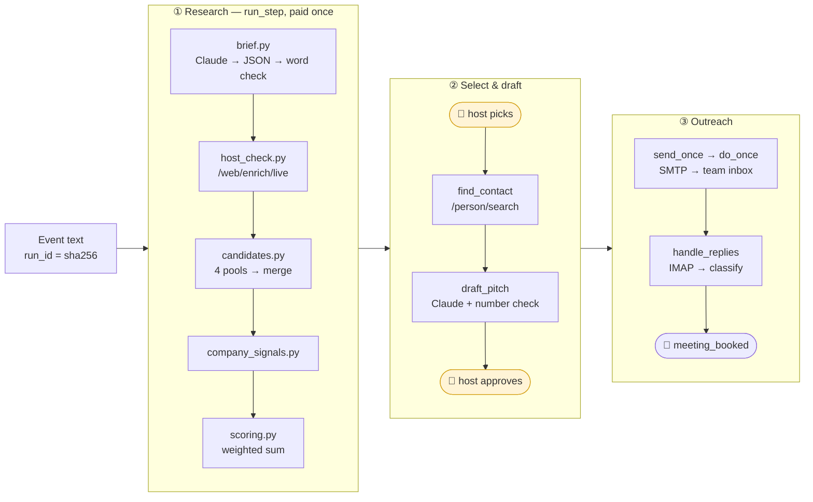
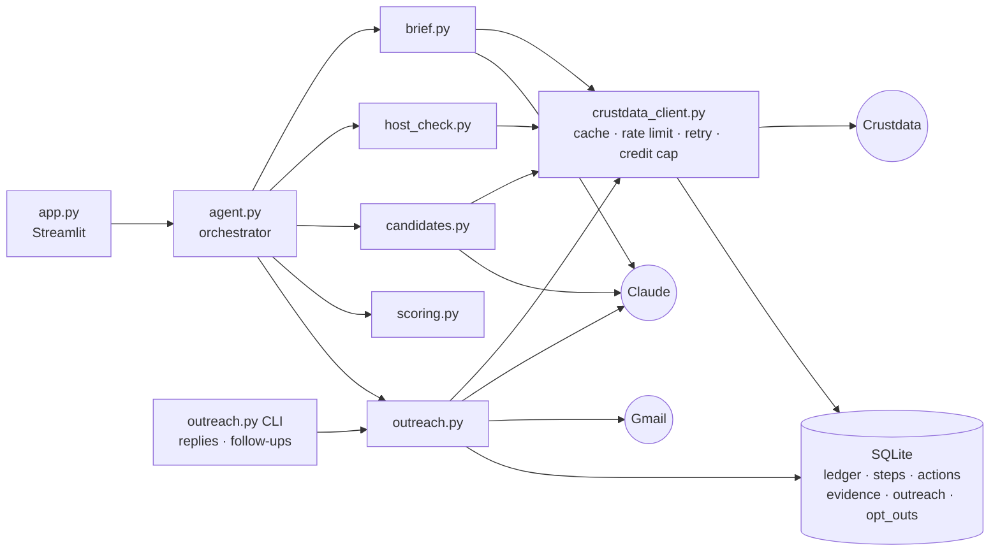
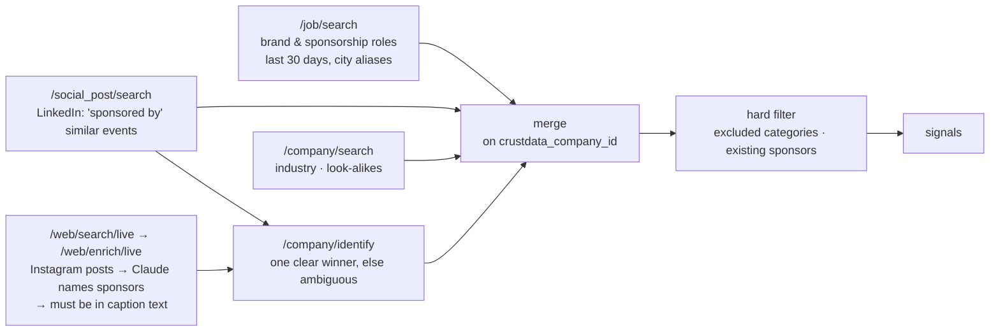
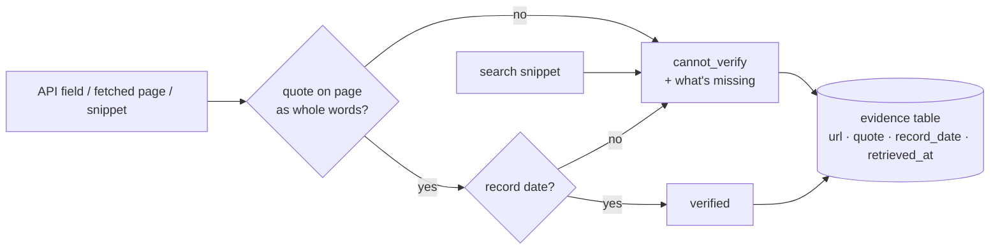
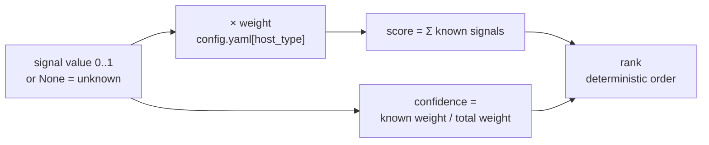
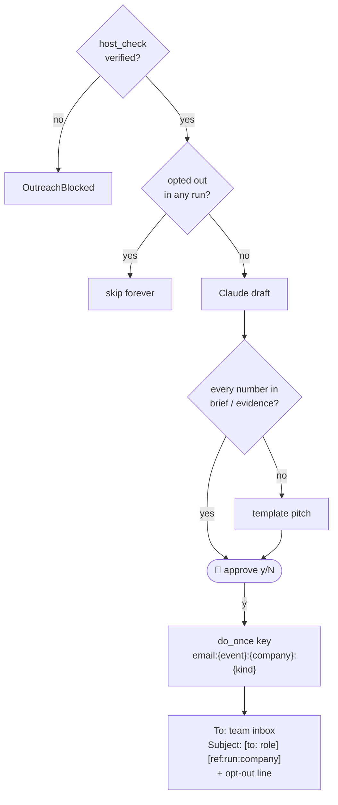
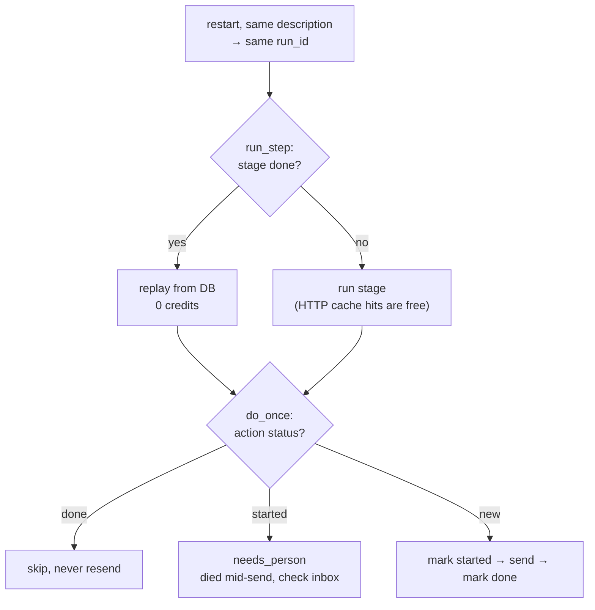
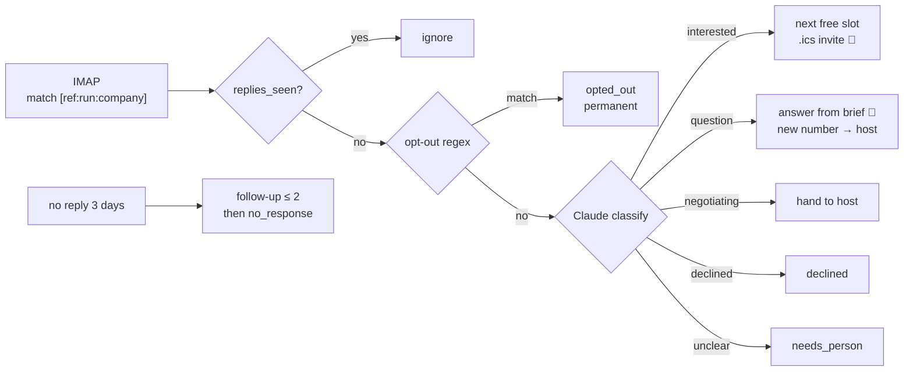
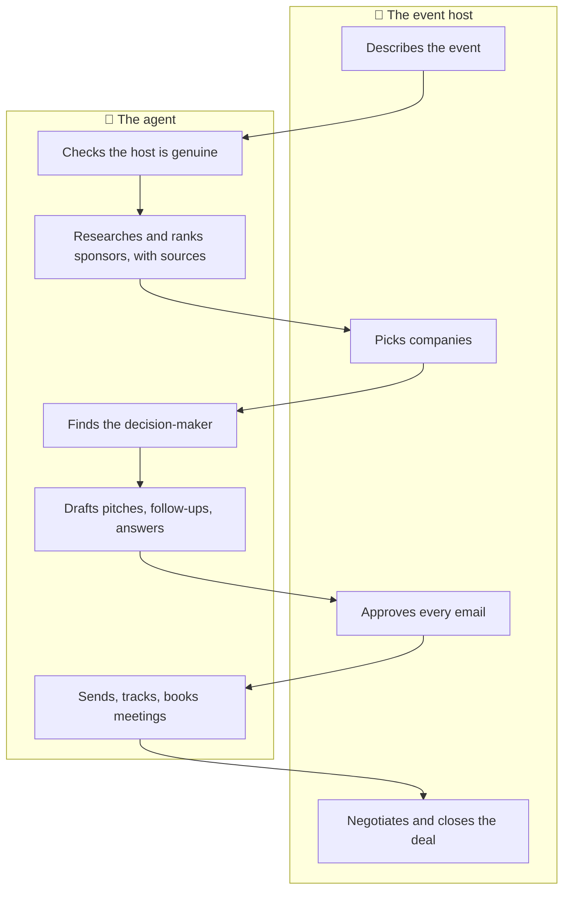

# Workflow

Two views of the same agent:

1. **[Technical workflow](#1-technical-workflow)**: pipeline, architecture, data sources, evidence, scoring, guard rails, crash recovery, replies, judge Q&A.
2. **[Business workflow](#2-business-workflow)**: the job as an event host sees it, step by step.

---

## 1. Technical workflow

### 1.1 End-to-end pipeline

Yellow = human gate

### 1.2 Architecture

### 1.3 Finding candidates (Crustdata)

### 1.4 Every fact → Evidence

### 1.5 Scoring

| Signal | University | NGO | Company | Community |
|---|---|---|---|---|
| Past sponsorships | **0.40** | **0.35** | **0.40** | **0.40** |
| Alumni / CSR | 0.15 / 0.05 | – / 0.25 | – | – |
| Size, funding, listing, followers, hiring, growth, city | rest | rest | rest | rest |

### 1.6 Outreach guard rails

### 1.7 Kill-on-stage recovery

### 1.8 Reply handling

### 1.9 Judge questions, one line each

| Question | Answer |
|---|---|
| Hallucination? | Model never supplies facts; names must be in source text; unsupported numbers → template |
| Why not AI ranking? | Code + config weights = same order every time, every point sourced |
| Missing data? | Unknown ≠ 0; shown as lower confidence |
| Source down? | Retry → listed as failed → person confirms; never read as "no sponsors" |
| Killed on stage? | Same run_id; `run_step` replays, `do_once` never resends (1.7) |
| Spam / phishing? | Host verified, team inbox only, human approves each, ≤ 2 follow-ups, opt-out permanent |
| Wrong company? | `/company/identify` must have one clear winner, else ambiguous |
| Wrong person? | Holds the role there now; title order; "Private Equity" etc. excluded |
| Cost? | Ledger per call; ~37 credits + $0.59 for 158 candidates; ~0.9 credits/contact; credit cap per run |
| Is ranking good? | `backtest.py` vs real past sponsors; first sample too small → "cannot verify" |
| Personal data? | One business contact per picked company, local SQLite, DPDP |

---

## 2. Business workflow

### 2.1 The job in one picture

An event host today pays a sponsorship agency, or keeps a team, to do this job by hand. The agent does the same job, and the host stays in charge of every decision that matters.

```mermaid
flowchart LR
    A["📝 Describe<br/>your event"] --> B["✅ We check<br/>you're real"]
    B --> C["🔍 Find likely<br/>sponsors"]
    C --> D["📊 Rank them<br/>with proof"]
    D --> E["👤 You pick<br/>who to approach"]
    E --> F["✉️ Write a<br/>pitch each"]
    F --> G["👤 You approve<br/>every email"]
    G --> H["📬 Send &<br/>follow up"]
    H --> I["💬 Handle<br/>replies"]
    I --> J["📅 Meeting<br/>booked"]

    style E fill:#fff4d6,stroke:#d4a017
    style G fill:#fff4d6,stroke:#d4a017
    style J fill:#d9f2e3,stroke:#2e8b57
```

Yellow marks the steps where you decide. Green is the result you're paying for.

### 2.2 Step by step

| # | Step | What happens | What you see |
|---|---|---|---|
| 1 | **Describe your event** | You write a few lines: event, date, city, audience, your organization and website, sponsorship tiers and prices, sponsors you already have, kinds of company to avoid. | A clean summary of your event. If something essential is missing, we ask instead of guessing. |
| 2 | **We check you're real** | We open your website and confirm it names your organization. | ✅ verified, or a clear reason why not. Without this, no emails go out. |
| 3 | **Find likely sponsors** | We look for companies that sponsored similar events recently, are hiring brand or partnership staff, are active in your city, or fit your industry. | A long list of candidate companies. |
| 4 | **Rank them with proof** | Each company is scored on what we can prove: past sponsorships, size, growth, funding, presence in your city, and alumni or CSR spend where it matters for your type of event. | A ranked list. Every reason links to its source and date, and anything we couldn't prove is marked "cannot verify". |
| 5 | **You pick** | You choose which companies to approach. | Only your picks go further. |
| 6 | **Find the right person** | For each pick we find the decision-maker, such as the head of partnerships or the brand manager. | Their name, title and profile link. |
| 7 | **Write a pitch each** | A short, personal email per company, using only facts about your event and that company. | A draft per company that you can read in full. |
| 8 | **You approve** | Nothing is sent until you approve it. | Pitches you approved are sent; the rest wait. |
| 9 | **Send and follow up** | Emails go out. If there's no reply after a few days we follow up, at most twice, then stop. | A live pipeline. |
| 10 | **Handle replies** | Questions are answered from your event details. Interested companies get a meeting invite. Anyone asking to negotiate goes straight to you. Anyone who says stop is never contacted again. | Each answer or invite waits for your OK. |
| 11 | **Meeting booked** | A calendar invite goes to the sponsor's decision-maker. | The meeting in your pipeline. |

### 2.3 Who does what

The agent never agrees prices or terms, never sends anything you haven't approved, and never contacts a company that has opted out.

### 2.4 What it replaces and what it costs

| | Today (agency or in-house team) | With the agent |
|---|---|---|
| Building the sponsor list | Hours of manual research per event | Minutes, with a source for every reason |
| Finding the right contact | LinkedIn searching by hand | Automatic, for your picks only |
| Writing pitches | Mail-merge templates | One tailored draft per company |
| Follow-ups and replies | Tracked in spreadsheets | Tracked automatically, every state explained |
| Cost | Agency retainer or a share of each deal *(figure to be sourced)* | About 37 data credits and $0.59 of AI to research one event, plus about 0.9 credits per contact (measured) |

**Proposed pricing** (for the team to decide): a per-event fee for the research and outreach, plus a success fee on each sponsorship closed from a meeting the agent booked.

### 2.5 The promises

- **Every claim has a source.** If we can't prove it, we say "cannot verify".
- **You approve everything that goes out.**
- **Nothing is sent twice**, even if the system crashes mid-job.
- **"Stop" means stop**, permanently.
- **Your data stays private.** We keep only business contact details, and only for companies you chose.
